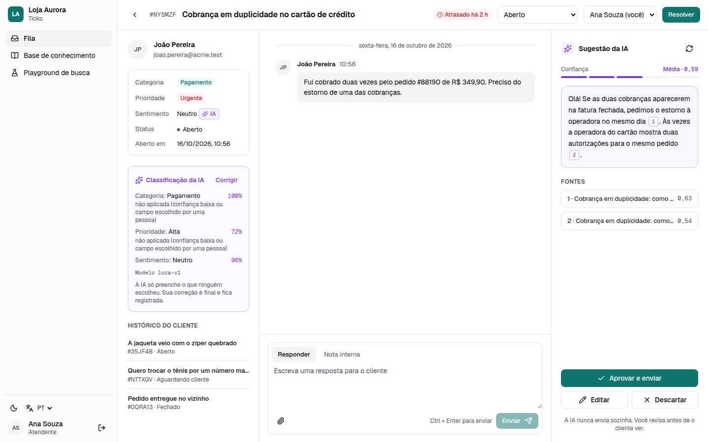
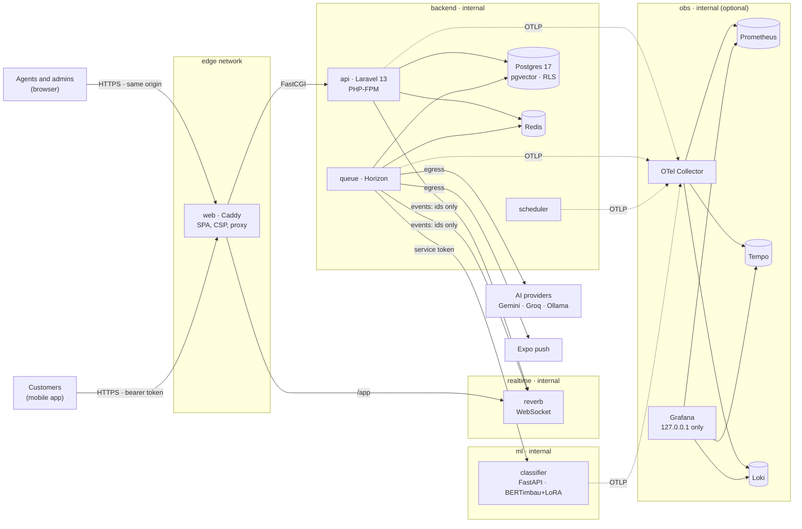
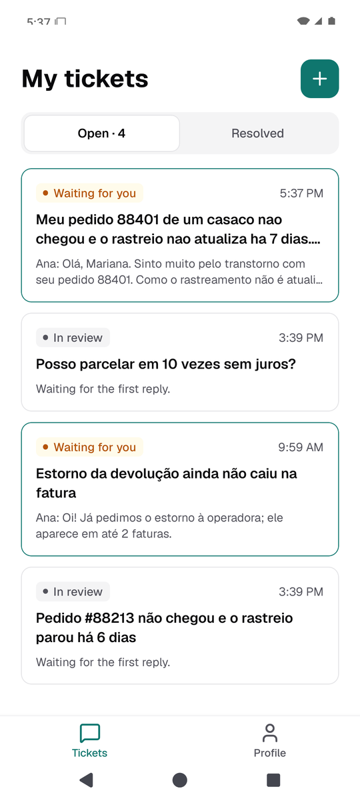
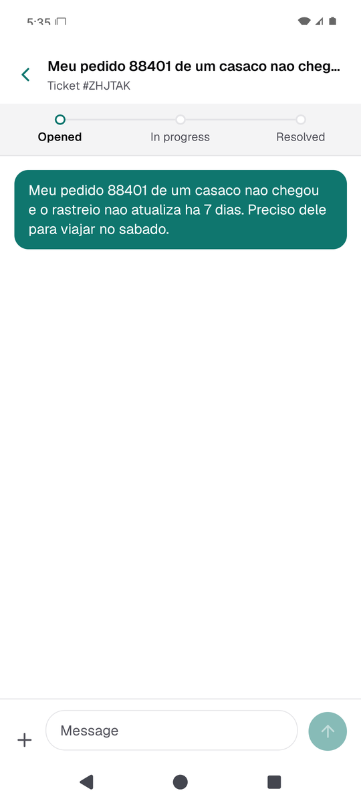
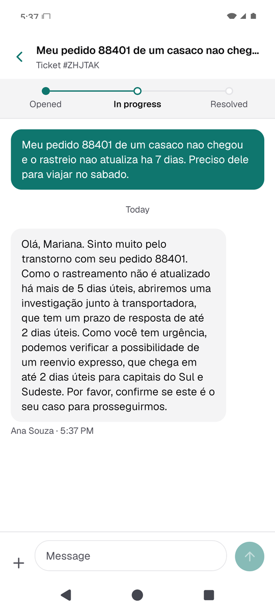

# Ticko

[](https://github.com/Hugueninfer/ticko/actions/workflows/ci.yml)
[](https://github.com/Hugueninfer/ticko/actions/workflows/security.yml)


**AI-assisted, multi-tenant helpdesk** for small online stores: a web app for agents and admins,
a mobile app for customers, reply suggestions grounded in the store's knowledge base (an agent
always approves), automatic ticket classification by a fine-tuned model, and full observability.
Everything runs locally with one command; the demo store, "Loja Aurora", is entirely fictional.

> 🇧🇷 Leia em português: [README.pt-BR.md](README.pt-BR.md) · 🎬 Demo guide: [docs/DEMO.md](docs/DEMO.md)



## What it does

| | |
| --- | --- |
| **Helpdesk** | Ticket queue with SLA deadlines, conversation with internal notes and images, assignment, categories with per-priority SLA targets, team management, admin dashboard. Multi-tenant with Postgres Row-Level Security. |
| **Customer app** | React Native (Expo): open tickets with photos, follow the conversation, push notifications and live updates. |
| **AI reply suggestions (RAG)** | Hybrid search (Portuguese full-text + pgvector) over the knowledge base; the model must cite its sources or say **"I don't know"**; **nothing reaches a customer without an agent's approval**. Gemini, Groq, Ollama or an offline fake. |
| **Ticket classification** | BERTimbau + LoRA, fine-tuned on a laptop CPU, fills category, priority and sentiment when nobody chose them; agents correct it and corrections are audited. |
| **Observability** | OpenTelemetry traces, metrics and logs (redacted) in Prometheus, Tempo, Loki and Grafana, with dashboards and alerts as code. |

## Architecture



Only Caddy publishes a port (and Grafana, on 127.0.0.1, when observability is on). Postgres,
Redis, Reverb, the classifier and the observability backends live on internal networks.

## Design decisions and trade-offs

| Decision | Why | Trade-off |
| --- | --- | --- |
| Laravel monolith + queue, not microservices | One codebase for auth, tenancy and policies; Horizon for background work | The classifier is the only separate service, because it is Python and CPU-heavy |
| Tenant isolation in the app **and** in Postgres (forced RLS, composite FKs) | A missing `where` cannot leak another tenant's data | Every query runs inside a tenant context; migrations and tests must set it |
| One origin for the web app (Caddy proxies the API) | Session cookies with CSRF, no tokens in the browser, no CORS with credentials | The SPA and the API deploy together |
| RAG with mandatory citations and "I don't know" | Answers must come from the store's own articles; low confidence is said, not invented | Fewer drafts than a free-writing model |
| Human approval for every AI reply (enforced by an architecture test) | The AI never talks to customers by itself | Agents still click "approve" |
| Offline `fake` AI provider by default | Demo, tests and CI work with no key and no data leaving the machine | Lexical relevance only; use a real provider to judge quality |
| Fine-tuned BERTimbau + LoRA on CPU instead of an LLM prompt | Fast (~50 ms), cheap, private, measurable (F1 per class); 26 min to train on a laptop | Synthetic training data: real-world accuracy must be validated with agents' corrections |
| Observability as an optional profile | Normal use stays light; telemetry is off unless asked for | PHP exports delta metrics per request; the Collector accumulates them |
| Everything in Docker, pinned by digest | `make up` is the whole setup; reproducible builds | First build downloads a lot (PyTorch and the base model with `make up-ml`) |

## Quick start

Requirements: Docker with Compose v2 and `make`. Nothing else (PHP, Composer and Node are
not needed on the host; Node 22 only for the web/mobile tooling).

```bash
make up        # creates .env with generated secrets, builds, migrates and starts
make demo      # seeds the demo store "Loja Aurora" and prints three passwords
```

| URL | What |
| --- | --- |
| http://localhost:8080 | The web app (one-click **Agent** / **Admin** demo sign-in) |
| http://localhost:8080/docs | Swagger UI for the API (OpenAPI 3) |
| http://localhost:8080/horizon | Queue dashboard (admins only) |

Optional parts, combinable:

```bash
make up-ml     # + the ticket classifier (first build downloads ~1 GB: PyTorch CPU + base model)
make up-obs    # + observability: Grafana on http://localhost:3001 (user admin, password in .env)
make demo-reset   # start the demo over
```

**AI providers** (all keys only in your local `.env`, never in the repository):

```bash
TICKO_AI_TEXT_PROVIDER=gemini        # fake (default) | gemini | groq | ollama
TICKO_AI_EMBEDDING_PROVIDER=gemini   # fake (default) | gemini | ollama  → then: make kb-reindex
GEMINI_API_KEY=...                   # or GROQ_API_KEY=..., or OLLAMA_URL=http://host.docker.internal:11434
```

Tested with the Gemini free tier: the default `gemini-3.7-flash` drafts cited, natural pt-BR
replies (~600 input / 60–230 output tokens, ~US$ 0.0005 per draft). The free tier allows only
about **20 requests per day per model** and refuses bursts; `make demo` paces its calls
(`TICKO_DEMO_AI_PAUSE`) and retries once, and `GEMINI_TEXT_MODEL=gemini-3.1-flash-lite` has its
own quota. Rotate a key after sharing it.

**Mobile app:** `make up-lan` (reachable on your Wi-Fi) and `make mobile-dev`, then scan the QR
code with Expo Go — see [apps/mobile/README.md](apps/mobile/README.md). Or on an **Android
emulator** on this computer, without Android Studio or sudo (needs KVM, Java 17+ and the Android
command-line tools in `~/Android/Sdk/cmdline-tools/latest`; ~3 GB, and ~8 GB free while it runs):

```bash
make android-setup     # SDK packages + the "ticko" AVD (Android 15); you accept Google's SDK licenses
make mobile-emulator   # boots it and opens the app in Expo Go, API on http://10.0.2.2:$WEB_PORT
```

<p>
  
  
  
</p>

Ports taken? Set `WEB_PORT` / `GRAFANA_PORT` (and `APP_URL`) in `.env`. Real tenants:
`docker compose exec api php artisan ticko:tenant:create <slug> "<Name>" --admin-email=<email>`.

## Classifier results

On 500 held-out synthetic tickets written with phrasings the models never saw (macro-F1):

| Task | TF-IDF + logistic regression | BERTimbau + LoRA |
| --- | --- | --- |
| Category | 0.879 | **0.941** |
| Priority | 0.575 | **0.709** |
| Sentiment | 0.350 | **0.991** |
| Labels unchanged under 576 prompt-injection attempts | 100% | 100% |

Training: 26 minutes on a laptop CPU (Intel Core 5 120U), 0.28% of the parameters trainable.
Per-class F1, confusion matrices and an honest discussion of the limits (synthetic data) are in
[services/classifier/README.md](services/classifier/README.md).

## Development

### Commands

| Command | Does |
| --- | --- |
| `make test` | Run the Pest suite (against the `ticko_testing` database) |
| `make coverage` | Tests with coverage; fails under 80% |
| `make lint` / `make fix` | Pint check / fix |
| `make stan` | Larastan at level `max` |
| `make audit` | `composer audit` |
| `make gitleaks` | Secret scan of the git history |
| `make docs` | Regenerate `apps/api/resources/openapi/openapi.json` with Scribe |
| `make ci` | Everything CI runs without the Docker stack (API, web, mobile, classifier, Semgrep, gitleaks) |
| `make trivy` | Scan the built images for fixable HIGH/CRITICAL vulnerabilities |
| `make backup` / `make backup-verify` | Encrypted database backup / prove it restores (scratch database, row counts compared) |
| `make demo-reset` | Delete the demo tenant and seed it again |
| `make screenshots` | Regenerate the screenshots in `docs/screenshots` from the running demo |
| `make web-dev` | Web app with hot reload on http://localhost:5173 (Node 22 + corepack) |
| `make web-test` | ESLint, Prettier, `tsc`, Vitest with coverage (web + API client) |
| `make up-lan` | The stack, reachable from phones on your Wi-Fi (only the web port) |
| `make mobile-dev` | Expo dev server for the mobile app (scan the QR code with Expo Go) |
| `make mobile-test` | ESLint, Prettier, `tsc`, Jest with coverage (mobile) |
| `make kb-reindex` | Re-embed every published article (after changing the embedding provider) |
| `make e2e` | Playwright against the running stack (`make up && make demo` first) |
| `make up-ml` | The stack plus the ticket classifier (first build downloads ~1 GB) |
| `make classifier-test` / `classifier-eval` | Classifier: lint, tests, pip-audit / F1 and prompt-injection evals |
| `make classifier-train` | Retrain the baseline and the LoRA model on the CPU (~26 min) |
| `make up-obs` | The stack plus observability: Grafana on http://localhost:3001 (admin password in `.env`) |
| `make e2e-obs` | Check Grafana: login required and every dashboard panel has data |
| `make obs-dashboards` | Regenerate the Grafana dashboards from code |
| `make down` / `make logs` | Stop / follow logs |

All PHP tooling runs inside the `dev` container (`docker compose --profile tools run --rm dev …`).
The web tooling needs Node 22 on the host (pnpm comes from corepack).

## Repository layout

```
apps/
  api/                Laravel 13 API (PHP 8.4)          ← phase 1
  web/                Web app: React + Vite              ← phase 2
  mobile/             Customer app: React Native + Expo  ← phase 3
services/
  classifier/         Ticket classifier: FastAPI + BERTimbau/LoRA ← phase 5
packages/
  api-client/         Typed client generated from the OpenAPI document (web + mobile)
infra/
  docker/php/         Multi-stage Dockerfile (dev, prod, web)
  docker/caddy/       Caddyfile
  docker/postgres/    Postgres + pgvector with security updates, no root
  postgres/init/      Creates the non-superuser application role
  observability/      Collector, Prometheus, Tempo, Loki, Grafana (dashboards and alerts as code)
docs/                 Demo guide, threat model, screenshots
scripts/              make env, encrypted backup and restore
compose.yaml          Local stack
Makefile              One-command workflows
```

The JavaScript side is a pnpm workspace (`pnpm-workspace.yaml`). `pnpm install` also generates
the API types from `apps/api/resources/openapi/openapi.json` (`pnpm api-client:generate`).

### Web app (`apps/web`)

React 19 + TypeScript (strict) + Vite, TanStack Query, React Router, Tailwind CSS with
shadcn-style components, React Hook Form + Zod, react-i18next (**pt-BR by default**, English).
Light and dark themes follow the design tokens: teal for every human action, violet only for
what comes from the AI. Screens: sign-in, ticket queue (Mine / Unassigned / All / Overdue,
filters, search, pagination), ticket detail (customer, conversation with internal notes and
images, AI panel placeholder), team, categories and SLA, and the admin dashboard.

The browser only ever talks to **one origin**: in Docker, Caddy serves the built app at `/` and
proxies `/api`, `/sanctum`, `/docs`, `/horizon` and `/up` to Laravel; with `make web-dev`, Vite
proxies the same paths to the stack. Sign-in uses Sanctum's session cookie and CSRF token; no
token is ever stored in the browser and there is no CORS configuration with credentials.

### Mobile app (`apps/mobile`)

The customer app: React Native with **Expo SDK 56**, Expo Router, TypeScript (strict), TanStack
Query, React Hook Form + Zod and the same i18n (pt-BR/English), tokens and Geist type as the
web app, in light and dark. Screens: sign-in (with a demo-customer shortcut only where the API
enables it), my tickets (coloured status, latest message), new ticket (text, photos from the
camera or gallery, optional topic), the conversation (chat, status timeline, photos) and the
profile with notification preferences; empty, loading, error and offline states throughout.

It signs in with **expiring Sanctum bearer tokens** kept in `expo-secure-store`, gets **push
notifications** through the Expo push service and **realtime** updates over Reverb. How to run
it on your phone (Expo Go on the same Wi-Fi, or a tunnel): [apps/mobile/README.md](apps/mobile/README.md).

### Realtime and push

- **Reverb** runs as its own container on an internal network; Caddy proxies only the WebSocket
  endpoint (`/app`) on the existing origin, so no new port is published. Events are broadcast
  on **private channels**: `tenant.{tenant}.tickets.{ticket}` (the requester and the tenant's
  staff) and `tenant.{tenant}.staff` (staff only), authorized in `routes/channels.php` by
  tenant and by the ticket policy at `POST /api/broadcasting/auth` (session or bearer token).
  Payloads carry **ids only**; clients refetch through the API. Internal notes reach the staff
  channel only. The agent web app refreshes its queue and conversations live.
- **Push:** when the team replies publicly or changes a ticket's status, a queued job sends a
  notification to the requester's registered devices through the Expo push API. The text
  never includes ticket content — only the reference ("New reply on ticket #4F2K9Z") — in the
  device's language, and honours the user's preferences. Devices are tied to the API token
  that registered them: signing out (revoking the token) unregisters the phone; devices Expo
  reports as unregistered are removed.

### Knowledge base and AI suggestions (RAG)

- **Knowledge base** (`/knowledge` in the web app): agents write Markdown articles, marked
  *staff and customers* or *staff only*. Publishing snapshots the text and a queued job splits
  it into passages (~320 tokens, 40 overlap) and embeds them (768-dimension vectors in
  pgvector, HNSW). The list shows indexing progress and failures (with retry); the editor
  shows "how the AI sees it". Drafts are never indexed; unpublishing removes an article from
  the AI at once. Markdown files can be imported.
- **Hybrid search**: Postgres full-text (Portuguese `tsvector`) plus pgvector cosine
  similarity, weighted or fused by rank (RRF). Every query filters by tenant (on top of RLS),
  published state and embedding model. The **search playground** shows exactly the passages
  and scores the AI receives.
- **Reply suggestions** (the AI panel of a ticket): an agent asks for a draft; a job searches
  the *customer-visible* articles with the customer's words and, only when the best passage
  scores above `TICKO_AI_MIN_CONFIDENCE`, asks the model for a JSON answer that must cite the
  provided passages (`[1]`). Otherwise — no good passage, the model says it cannot answer,
  or it cites a source it was not given — the panel says **"I don't know"**, lists the
  closest articles and lets the agent report a knowledge gap. Provider failures show an error
  code and a retry; the queue keeps working.
- **The AI never answers a customer by itself.** A draft reaches the customer only when an
  agent approves it (as is or edited); source markers are removed; discards record a reason.
  An architecture test forbids the AI side of the code from posting messages.
- **Prompt injection:** rules live in the system instruction; ticket text and passages are
  untrusted data inside delimiters with a random per-request nonce (look-alike tags are
  stripped); the model has no tools; its output must be valid JSON with valid citations;
  only minimal ticket data is sent (subject, messages, the customer's first name — no e-mail
  or account data).
- **Providers** (`.env`, behind `TextGenerator` / `Embedder` interfaces):

  | Setting | Values |
  | --- | --- |
  | `TICKO_AI_TEXT_PROVIDER` | `fake` (default, offline), `gemini`, `groq`, `ollama` |
  | `TICKO_AI_EMBEDDING_PROVIDER` | `fake` (default), `gemini`, `ollama` — Groq has no embeddings |
  | `GEMINI_API_KEY`, `GROQ_API_KEY` | Only in your local `.env`; sent in headers, never logged |
  | `OLLAMA_URL` | e.g. `http://host.docker.internal:11434` for Ollama on your computer |

  The `fake` provider (hashed word stems and extractive answers) makes development, the demo,
  tests and CI work without any key; its relevance is lexical only, so judge search quality
  with a real embedding model. Changing the embedding provider needs `make kb-reindex`.
  **Privacy:** on Gemini's free tier Google may use submitted data to improve its products —
  use a paid key or Ollama for real customer data.

### Ticket classification (`services/classifier`)

- New tickets are classified in the background (`ClassifyTicket` job) into **category**,
  **priority** and **customer sentiment** by a BERTimbau model fine-tuned with LoRA on a
  synthetic, fully fictional pt-BR dataset. Full report — dataset, baseline vs LoRA per-class
  F1 and confusion matrices, training time on a laptop CPU — in
  [services/classifier/README.md](services/classifier/README.md).
- The AI fills **only what nobody chose** and only above `CLASSIFIER_MIN_CONFIDENCE` (0.6);
  lower-confidence suggestions are stored and shown, not applied. Priority changes recompute
  the SLA deadlines.
- Agents see an **"AI" badge** on each field the classifier set and a *AI classification* card
  with its suggestions and confidences; **Correct** sets the values for good
  (`PATCH /api/v1/tickets/{id}/classification`). Corrections of AI values are stored in
  `classification_corrections` (future training data) and both the automatic classification
  and the correction go to the append-only `audit_events`.
- Off by default: `make up-ml` starts the classifier and points the API at it. The service
  lives on an internal network reachable only by the queue, with a service token; the API
  masks personal data before sending and validates the answer against closed enums.

### Observability (`infra/observability`)

- `make up-obs` adds an OpenTelemetry Collector, Prometheus, Tempo, Loki and Grafana. The API,
  the queue, a new `scheduler` service and the classifier send traces, metrics and logs over
  OTLP; one trace follows a ticket from the API request through the queue to the classifier.
- Five provisioned dashboards (API health, queue, tickets and SLA, AI suggestions, classifier)
  and alert rules (failed sign-in spike, 403/404 bursts, AI errors and cost, SLA breaches).
- Telemetry is redacted twice (Laravel and the Collector): no passwords, tokens, cookies, keys,
  ticket text or personal data; metric labels are bounded (no user or ticket ids).
- Grafana requires login (generated admin password, no anonymous access) and listens on
  127.0.0.1 only. Off by default. Details: [infra/observability/README.md](infra/observability/README.md).

## Reference

### API layers (`apps/api`)

| Layer | Location | Responsibility |
| --- | --- | --- |
| Routes | `routes/api.php` | Versioned under `/api/v1`, grouped by middleware (auth, throttling, signatures) |
| Controllers | `app/Http/Controllers/Api/V1` | Thin: authorize, call one action, return a resource |
| Form requests | `app/Http/Requests` | Authorize (before validating) and validate input |
| Actions | `app/Actions` | One use case each (`CreateTicket`, `AssignTicket`, …); no HTTP knowledge |
| Services | `app/Services` | Reusable domain services (`ImageSanitizer`) |
| Policies | `app/Policies` | Per-role, per-tenant authorization rules |
| Resources | `app/Http/Resources` | JSON output; never expose internal columns |
| Models | `app/Models` | ULID keys, explicit `$fillable`, `BelongsToTenant` |
| Errors | `app/Exceptions/ProblemDetailsRenderer.php` | RFC 7807 `application/problem+json` |

Every PHP file declares `strict_types`.

### Multi-tenancy

Every tenant-owned table has a `tenant_id`. Isolation is enforced twice:

1. **Application:** the `BelongsToTenant` trait adds a global scope (and matches nothing
   when no tenant is set) and fills `tenant_id` on create from the current context.
2. **Database:** Postgres Row-Level Security policies, `FORCE`d so they apply to the table
   owner as well, only expose rows where `tenant_id = current_setting('app.tenant_id')`.
   The application connects with a role that is neither superuser nor `BYPASSRLS`.
   Composite foreign keys (`tenant_id`, `id`) stop rows from referencing another tenant.

The `ResolveTenant` middleware runs before authentication and sets the context (and the
Postgres setting) from, in order: the tenant bound to the bearer token, the tenant stored in
the session at login, the tenant inside a valid signed URL, or the `X-Tenant` header (slug,
used to log in). A stronger source always wins, so a client cannot switch tenants with the
header.

### Roles

| | customer | agent | admin |
| --- | --- | --- | --- |
| Tickets | own only; open, close/reopen, reply, upload | all; any status, assign, internal notes | as agent |
| Categories | list | list | manage |
| Team | — | list | list, create, change role, deactivate |
| Horizon | — | — | yes (allow-listed outside `local`) |

### Main endpoints (`/api/v1`)

| Method | Path | |
| --- | --- | --- |
| POST | `/auth/login`, `/auth/logout` | SPA session (Sanctum cookie) |
| GET / POST | `/auth/demo` | Demo sign-in (only with `TICKO_DEMO_LOGIN`, never in production) |
| POST / DELETE | `/auth/tokens`, `/auth/tokens/current` | Mobile bearer tokens |
| POST | `/auth/demo/tokens` | Demo customer token for the mobile app (same rules as `/auth/demo`) |
| GET / PUT | `/auth/me`, `/auth/password`, `/auth/notification-preferences` | Current user |
| POST / DELETE | `/push-devices`, `/push-devices/current` | Register / unregister this phone for push (bearer tokens) |
| GET | `/realtime` | Public Reverb key for clients (`/api/broadcasting/auth` authorizes channels) |
| CRUD | `/knowledge/articles` (+ `/import`, `/{id}/publish`, `/unpublish`, `/reindex`, `/chunks`) | Knowledge base (staff; delete: admins) |
| GET / POST | `/knowledge/stats`, `/knowledge/search` | Figures and hybrid search (playground) |
| GET / POST | `/tickets/{id}/suggestions/latest`, `/tickets/{id}/suggestions` | AI reply draft (staff) |
| POST | `/suggestions/{id}/approve`, `/discard`, `/gap` | Agent decisions on a draft |
| GET / POST | `/tickets` | List (filters `status`, `state` (`active`/`done`), `priority`, `category_id`, `assignee_id`, `requester_id`, `unassigned`, `overdue`, `q`, `sort`, pagination) / open |
| GET | `/tickets/{id}` | Show |
| PATCH | `/tickets/{id}/status`, `/tickets/{id}/assignee` | Change status / assign |
| GET / POST | `/tickets/{id}/messages` | Conversation (internal notes for staff) |
| GET / POST | `/tickets/{id}/attachments` | Images |
| GET | `/attachments/{id}`, `/attachments/{id}/content` | Metadata + signed URL / signed download |
| CRUD | `/categories` | Categories, with per-priority SLA overrides |
| GET / POST / PATCH | `/team`, `/team/{id}` | Members (search `q`, open ticket counts) |
| GET | `/metrics` | Admin dashboard: volume, median first response, SLA compliance |

**SLA:** each ticket gets first-response and resolution deadlines when it is opened, from its
category's targets or the per-priority defaults in `config/ticko.php` (calendar time; business
hours are not modelled yet). The first public staff reply is recorded; `?overdue=1` lists
unresolved tickets with a missed deadline.

The complete, always-current reference is the Swagger UI at `/docs`.

## Configuration

`make env` writes `.env` from [`.env.example`](.env.example) and generates
`APP_KEY` and the database and Redis passwords. `.env.example` contains **no secrets**.
Ticko-specific settings live in `apps/api/config/ticko.php` (`TICKO_*` variables: token
lifetime, rate limits, upload size, signed-URL lifetime, docs toggle, Horizon allow-list).

## Testing and quality

- **Pest** unit, feature and architecture suites; coverage gate of **80%** (`make coverage`).
- **Tenant isolation:** every endpoint that targets a single resource is called by an admin of
  another tenant and must answer `404` without changing data; a meta-test fails if a new
  route is missing from that list. RLS is tested with raw SQL.
- **Authorization:** role matrices for tickets, messages, attachments, categories and team.
- **Architecture:** strict types, thin final controllers, readonly actions, explicit
  `$fillable`, and a test that fails if an API controller action never calls `authorize()`
  (public endpoints must be rate limited or signed).
- **Static analysis:** Larastan at level `max`. **Style:** Pint.
- **Web:** ESLint (strict type-checked, React hooks, jsx-a11y), Prettier, `tsc` strict,
  Vitest + Testing Library against the real route tree (coverage gate of 80%), and Playwright
  end-to-end tests against the Docker stack (sign-in, queue, reply and internal note, admin
  pages, categories, team), which also fail on any CSP violation.
- **Mobile:** ESLint (strict type-checked, hooks; AsyncStorage and `console` forbidden),
  Prettier, `tsc` strict, Jest + React Native Testing Library against a fake API (coverage
  gate of 80% of lines), and an Android bundle build with production settings.
- **Knowledge base and AI:** Pest tests with the providers' HTTP APIs faked (request shapes,
  keys in headers, error codes), chunking, hybrid search (tenant isolation with identical
  articles in two tenants, drafts/archived/staff-only exclusion, embedding-model mismatch),
  drafting (citations required, "I don't know" without calling the model, prompt-injection
  delimiters, staff-only articles never in prompts) and approval; Vitest for every panel
  state; Playwright for indexing, the playground and approving a draft.
- **Push and realtime:** Pest tests with the Expo API faked (content-free text, preferences,
  unregistered devices, tenant isolation of devices) and channel authorization by tenant
  and ticket.
- **CI** (GitHub Actions): lint, Larastan, tests + coverage, `composer audit`, gitleaks,
  Docker image builds, web lint/types/tests/build/`pnpm audit`, the mobile job, the classifier
  (tests, `pip-audit`, F1 and prompt-injection evals), the end-to-end suite with a backup
  restore check, and the observability stack (Grafana login, every panel has data, no personal
  data in stored logs).
- **Security workflow** (every PR, `main` and weekly): CodeQL (JavaScript/TypeScript, Python,
  Actions), Semgrep (PHP, secrets), Trivy on every image (fails on fixable HIGH/CRITICAL;
  accepted findings with a reason and an expiry in `.trivyignore.yaml`), SPDX SBOMs of the
  repository and the images. Dependabot opens weekly grouped updates.

## Security

See [SECURITY.md](SECURITY.md) to report a vulnerability and
[docs/THREAT-MODEL.md](docs/THREAT-MODEL.md) for the STRIDE threat model of sign-in, the
customer's ticket and the AI suggestion. Highlights:

- **Isolation:** global scope + forced RLS + composite foreign keys + non-privileged DB role.
- **Auth:** Sanctum cookies for the SPA (CSRF-protected), expiring tenant-bound tokens
  (prefixed `ticko_` so leaked tokens are caught by secret scanners) for mobile; tokens are
  revoked on deactivation or role change, and the other tokens on password change.
- **Passwords:** Argon2id; minimum 12 characters; rejected if found in known breaches
  (HIBP k-anonymity API).
- **No user enumeration:** login answers with one generic error, whether the tenant, the
  e-mail or the password is wrong, and always costs one Argon2id verification.
- **Rate limits:** login per account and per IP, API per user, uploads per user; `429`
  responses carry `Retry-After`.
- **Authorization before validation:** form requests check the policy first, so validation
  errors never leak information (e.g. "e-mail already taken") to unauthorized callers.
  Foreign resources answer `404`, not `403`.
- **Uploads:** JPEG/PNG/WebP detected from content, max 5 MB and 40 MP, decoded and
  re-encoded (drops EXIF/GPS and appended payloads), random file names on a private disk,
  served only through 5-minute signed URLs with `nosniff` and a sandboxing CSP.
- **Errors:** RFC 7807 problem details; no stack traces or internal messages unless
  `APP_DEBUG=true`.
- **HTTP:** security headers at the edge; the web app is served under a strict CSP (only
  same-origin scripts, styles, fonts, images and requests; no inline code, no framing); the
  docs page uses a nonce-based CSP with SRI.
- **Web app:** session cookie only (httpOnly; nothing in `localStorage`/`sessionStorage` but
  the theme, language and last company identifier), user content always rendered as text
  (lint forbids `dangerouslySetInnerHTML` and HTML string writes), no secrets in `VITE_*`
  variables, role checks in the UI for navigation only — the API authorizes every request.
- **Mobile app:** bearer token only in `expo-secure-store` (Keychain/Keystore, this device
  only), expiring and revoked on sign-out; HTTPS required outside development (plain HTTP only
  to private addresses in dev); deep links and notification payloads accept only well-formed
  ticket ids and the API re-checks access; photos re-encoded on the phone (no EXIF/GPS) and
  again by the API; no secrets in `EXPO_PUBLIC_*`; no logging of personal data.
- **AI:** suggestions only from customer-visible, published articles of the caller's tenant;
  citations verified; low confidence means "I don't know"; nothing is sent without an agent;
  untrusted text delimited; keys only in `.env`; provider calls only from queued jobs (the queue
  has egress; Postgres and Redis still have none).
- **Realtime/push:** private channels only, authorized per tenant and ticket; events carry ids,
  never content; push notifications carry only the ticket reference. Reverb's publishing API
  is not exposed, and clients cannot send events to each other.
- **Classifier:** internal network only (no port, no egress) with a service token; PII masked
  before sending; ticket text never logged; output validated against closed enums and rendered
  as text; base model pinned by revision and SHA-256, safetensors only (no pickle); hash-locked
  Python dependencies with `pip-audit`; F1 and prompt-injection evals in CI; minimal non-root
  image pinned by digest. Details: [services/classifier/README.md](services/classifier/README.md#security).
- **Observability:** Grafana with mandatory login (generated admin password, no anonymous or
  basic auth), on 127.0.0.1 only; Collector and backends on an internal network; telemetry
  redacted in Laravel and again in the Collector, tested and checked in CI; bounded metric labels;
  images pinned by digest and non-root. Details: [infra/observability/README.md](infra/observability/README.md#security).
- **Containers:** non-root, read-only filesystems, all capabilities dropped,
  `no-new-privileges`; Postgres and Redis unreachable from the host; Redis password-protected.
- **Supply chain:** `composer audit`, `pnpm audit`, `pip-audit`, gitleaks, CodeQL, Semgrep,
  Trivy, SBOMs, Dependabot; every base image and Action pinned by digest/SHA; least-privilege
  tokens.
- **Backups:** `make backup` writes `pg_dump` encrypted with AES-256 (PBKDF2, 600k iterations)
  and a passphrase generated by `make env`; the plain dump never touches the disk;
  `make backup-verify` (also in CI) restores it into a scratch database and compares every
  table. Restore: `scripts/restore.sh <file> --into <db>` or `--replace --yes`.

## Contributing

See [CONTRIBUTING.md](CONTRIBUTING.md).

## License

Proprietary — all rights reserved. See [LICENSE](LICENSE).
