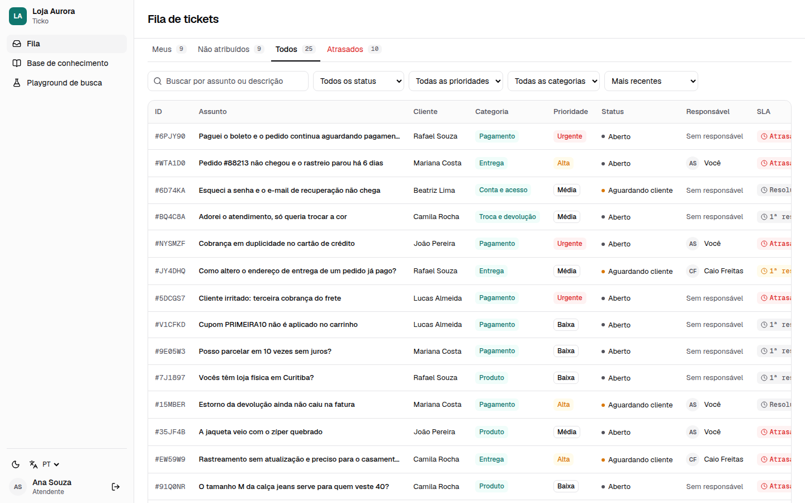
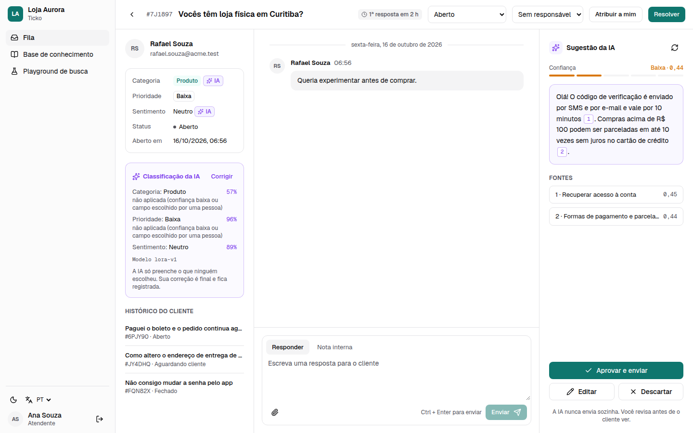
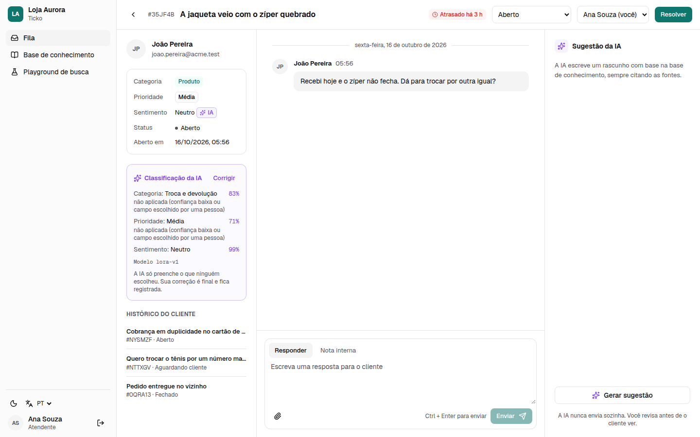
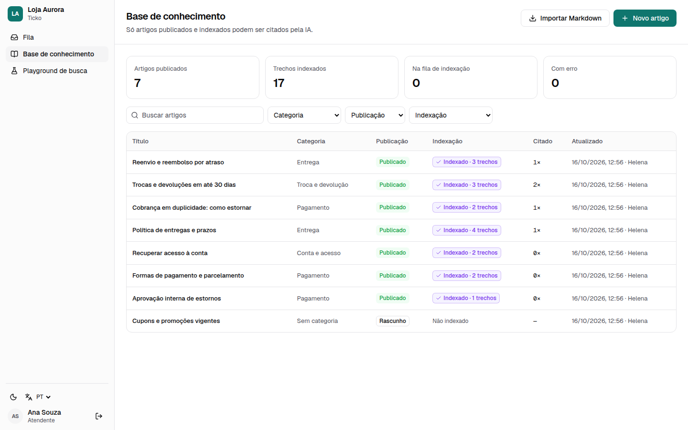
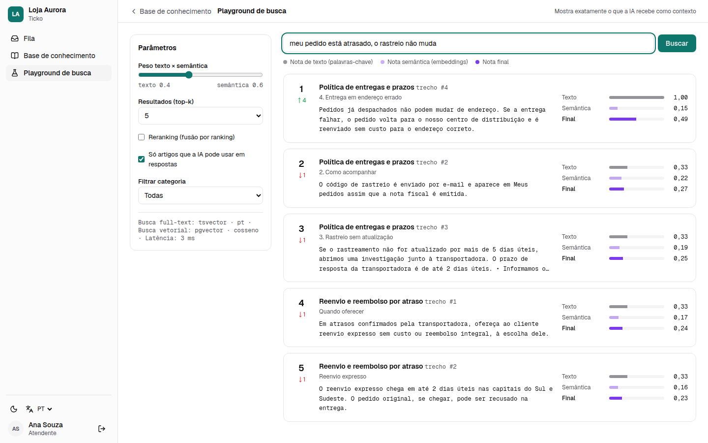
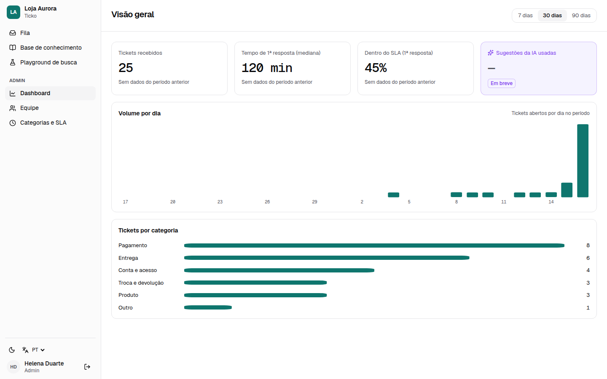
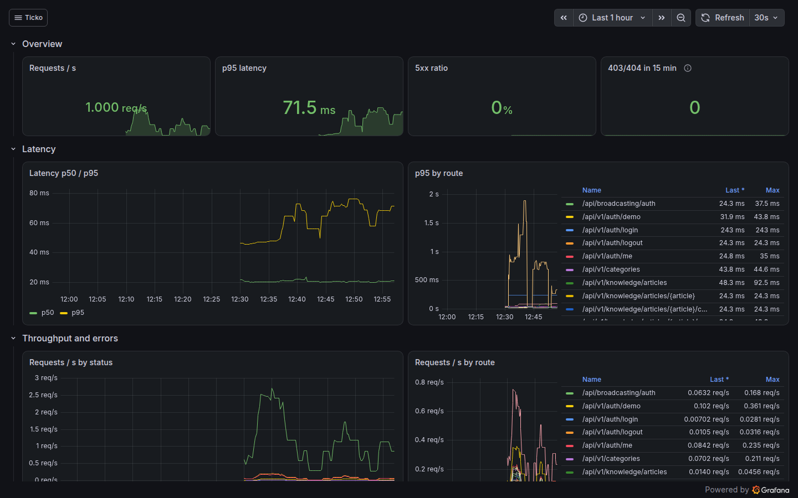
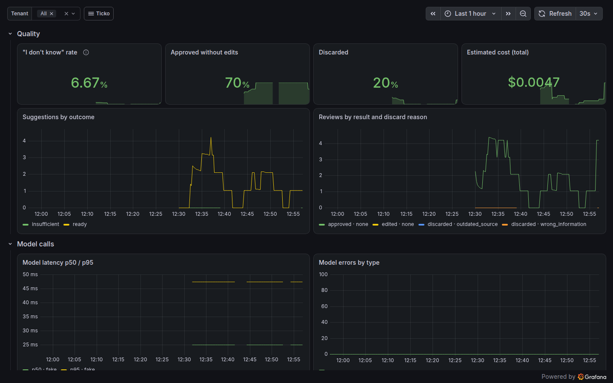
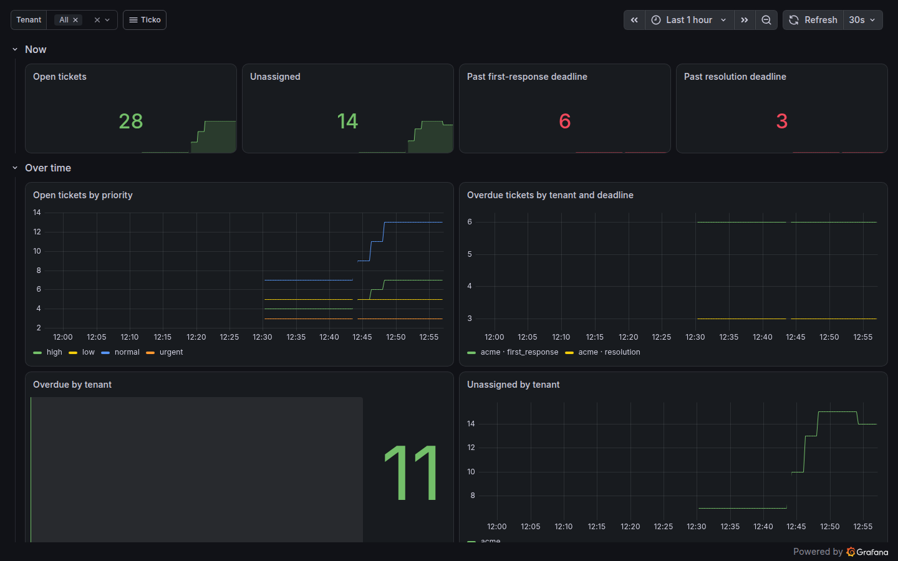
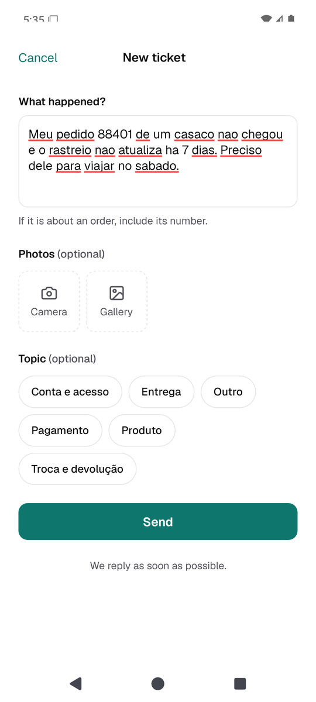

# Demo guide (5–10 minutes)

*[Português](DEMO.pt-BR.md)*

Everything below is fictional: "Loja Aurora", its customers, orders and amounts.

## Setup (once, ~5 minutes the first time)

```bash
make up-obs          # the app + Grafana (add make up-ml first for the real classifier)
make demo            # prints the admin, agent and customer passwords
```

Open http://localhost:8080 — the sign-in page has one-click **Atendente** (agent) and **Admin**
buttons. Grafana: http://localhost:3001 (user `admin`, password `GRAFANA_ADMIN_PASSWORD` in `.env`).
To start over: `make demo-reset`.

## The script

**1. The queue (1 min).** Sign in as **Atendente** (Ana Souza). The queue shows 25 tickets: open,
waiting on the customer, resolved and closed, with SLA timers — some already **overdue** (red).
Try the tabs (*Meus*, *Não atribuídos*, *Todos*, *Atrasados*) and the filters.



**2. An AI draft, with sources (2 min).** Open *"Cobrança em duplicidade no cartão de crédito"*.
On the right, the AI drafted a reply from the knowledge base: every claim cites a source
(`[1]`, `[2]`); click a source to see the exact passage. The confidence bar says how sure it is.
**Nothing is sent until you approve** — *Aprovar e enviar*, *Editar* or *Descartar* (with a reason).
On the left, the **AI classification** card shows what the classifier suggested and what it applied.


**3. "I don't know" (30 s).** Open *"Vocês têm loja física em Curitiba?"*. The knowledge base has
no answer, so the AI says it does not know, lists the closest articles and lets the agent report
the gap — it never makes things up.



**4. Correcting the classifier (1 min).** Open *"A jaqueta veio com o zíper quebrado"*. The AI
suggested a category; an agent corrected it to *Produto*. Corrected fields lose
the **IA** badge, the AI never changes them again, and the correction is audited (and is
training data for the next model). Try **Corrigir** on *"Adorei o atendimento, só queria trocar a cor"*.



**5. Knowledge base and search (1 min).** *Base de conhecimento*: articles for customers or
staff only, with indexing status. *Playground de busca*: type "meu pedido está atrasado" and see
exactly the passages and scores the AI would receive (full-text + semantic).




**6. Admin (30 s).** Sign out and sign in as **Admin**: volume, median first response, SLA
compliance; team and categories with per-priority SLA targets.



**7. Observability (2 min).** In Grafana, folder **Ticko**:
- *API health*: latency p50/p95 by route, errors, 403/404 bursts, redacted logs linked to traces;
- *AI suggestions*: "I don't know" rate, approvals and discards, tokens and estimated cost per tenant;
- *Tickets and SLA*: open, unassigned and overdue tickets per tenant;
- *Classifier* and *Queue*. Five alert rules are provisioned (failed sign-ins, 403/404 bursts,
  AI errors and cost, SLA breaches).

With `make up-ml`, create a ticket from the mobile app and follow **one trace** in Tempo from the
API request through the queue to the Python classifier.





**8. The customer's side (optional, 2 min).** `make android-setup` once, then
`make mobile-emulator` (Android emulator on this computer) — or `make up-lan` + `make mobile-dev`
and Expo Go on your phone. Sign in as the demo customer (Mariana Costa) and open a ticket without
a topic: the classifier fills category and priority, the agent approves the AI draft in the web
app, and the reply appears in the app **live**, with the status moving to *In progress*.

<p>
  
  
  
</p>


## Regenerating the screenshots

```bash
make up-obs && make demo && make screenshots
```

The mobile screenshots (`docs/screenshots/mobile-*.png`) were taken on the Android emulator
(`make mobile-emulator`, `adb exec-out screencap`).
